# محفظتي · Mahfazati

<div align="center">


[](https://github.com/qusaykhadour/mahfazati/releases/latest)

</div>

<div dir="rtl">

## 💰 محفظتي — دفتر حساباتك الشخصي على هاتفك، بلا إنترنت وبلا خوادم

تطبيق أندرويد مفتوح المصدر لإدارة المال الشخصي مصمم للسياق السوري: يعمل **بشكل كامل دون إنترنت**، يحفظ كل بياناتك **مشفّرة محلياً على جهازك فقط**، ويفهم واقع التعامل بعملات متعددة مع أسعار صرف متغيرة.

### لماذا محفظتي؟
- **بلا إنترنت أولاً**: كل شيء يعمل أوفلاين — لا حسابات، لا تسجيل دخول، لا خوادم. بياناتك لا تغادر جهازك أبداً.
- **عملات متعددة بأسعار واقعية**: ليرة سورية (سوق سودا ورسمي)، دولار، يورو، ليرة تركية، يوان — مع أسعار شراء/بيع منفصلة كما في السوق الفعلية.
- **أسعار تلقائية أو يدوية**: حدّث أسعار السوق السودا (دمشق) بضغطة زر من مصدر sp-today، أو أدخلها يدوياً.
- **حماية بالبصمة/الوجه**: قفل التطبيق مع قفل تلقائي بعد ربع ساعة غياب، ووضع إخفاء الأرقام، ومنع لقطات الشاشة.
- **تشفير كامل**: البيانات المالية والنسخ الاحتياطية الداخلية محفوظة مشفّرة AES-256 ومفتاحها داخل Android Keystore.
- **نسخ احتياطي ذكي**: نسخة تلقائية يومية (آخر ٧ أيام) + تصدير/استيراد كامل بصيغة JSON + نسخة أمان قبل أي استرجاع.

### المميزات
| الميزة | الوصف |
|---|---|
| 🏠 الرئيسية | إجمالي الثروة بجميع العملات محوّلاً للليرة والدولار |
| 💳 الحسابات | نقداً، مصرف، محافظ إلكترونية — بعملات مختلفة |
| ➖➕ المعاملات | مصروف/دخل/تحويل بين حسابات مع تحويل عملات تلقائي |
| 🤝 الديون | «لي عند الناس» و«عليّ للناس» مع تتبع المسدَّد |
| 🎯 المدخرات | أهداف ادخار مع شريط تقدم |
| 📊 التقارير | توزيع المصاريف بالتصنيفات ورسوم بيانية |
| ⚙️ الإعدادات | ثيم فاتح/داكن، تصنيفات مخصصة، أسعار صرف، أمان |

### التقنيات
React Native 0.88 · Expo SDK 58 · expo-router · TypeScript · Hermes · AES-256 (aes-js) + Android Keystore

---

## 📱 لقطات من التطبيق · Screenshots

<table>
  <tr>
    <td align="center">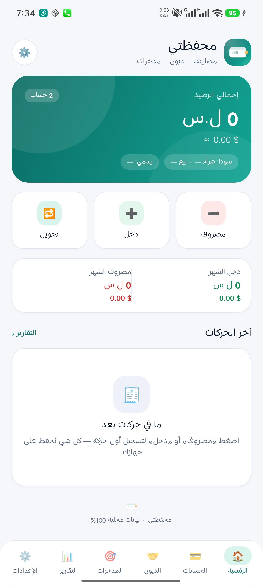<br/><b>🏠 الرئيسية</b><br/><sub>إجمالي الرصيد بكل العملات</sub></td>
    <td align="center">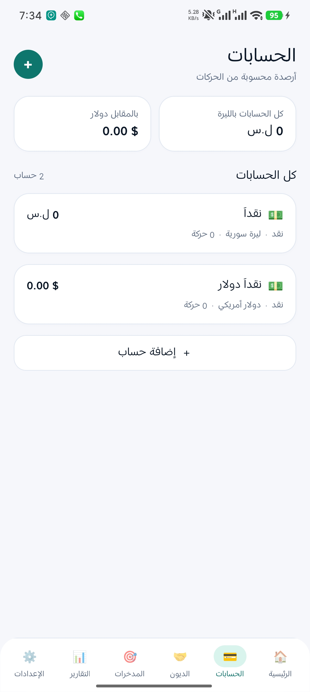<br/><b>💳 الحسابات</b><br/><sub>نقداً، مصرف، محافظ إلكترونية</sub></td>
    <td align="center">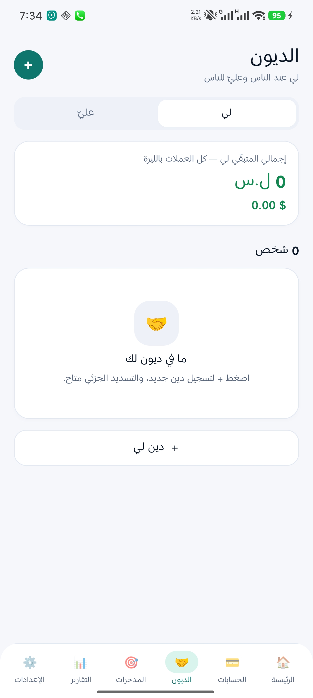<br/><b>🤝 الديون</b><br/><sub>لي عند الناس وعليّ للناس</sub></td>
    <td align="center">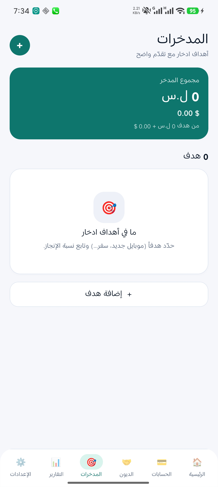<br/><b>🎯 المدخرات</b><br/><sub>أهداف ادخار مع شريط تقدم</sub></td>
  </tr>
  <tr>
    <td align="center">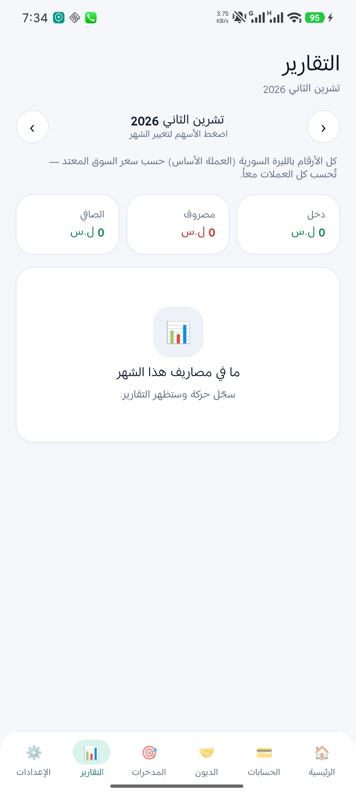<br/><b>📊 التقارير</b><br/><sub>توزيع المصاريف شهرياً</sub></td>
    <td align="center">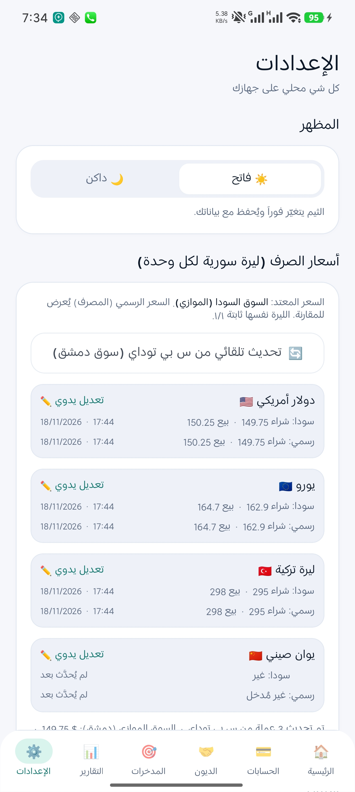<br/><b>💱 أسعار الصرف</b><br/><sub>السوق السودا والرسمي · تحديث تلقائي</sub></td>
    <td align="center">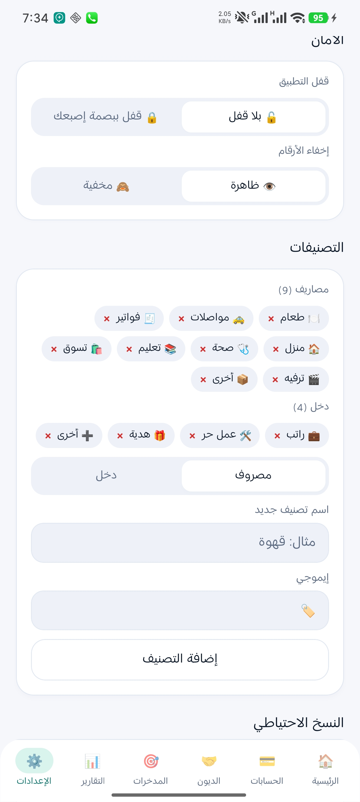<br/><b>🔒 الأمان والتصنيفات</b><br/><sub>قفل بالبصمة · إخفاء الأرقام</sub></td>
    <td align="center">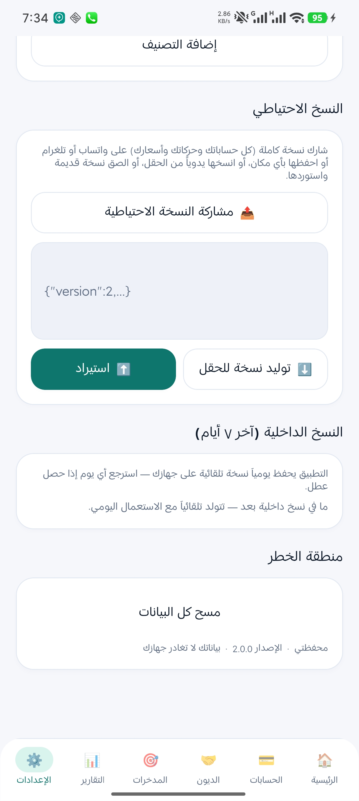<br/><b>💾 النسخ الاحتياطي</b><br/><sub>تصدير/استيراد · نسخ داخلية ٧ أيام</sub></td>
  </tr>
  <tr>
    <td align="center">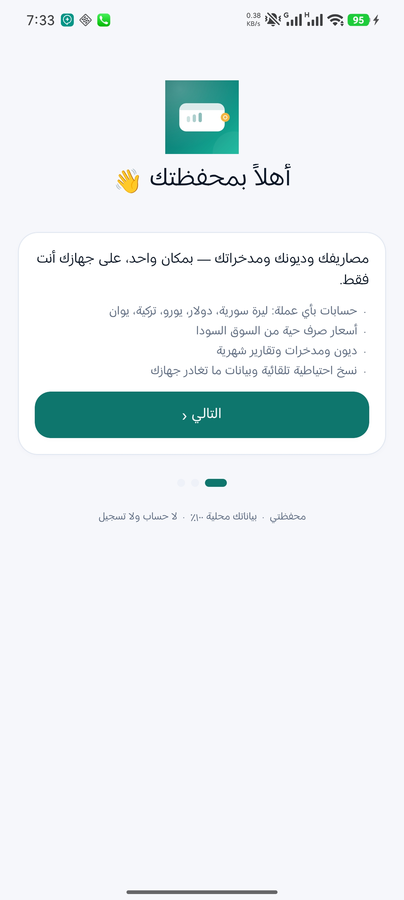<br/><b>👋 الترحيب</b><br/><sub>واجهة عربية محلية بالكامل</sub></td>
    <td align="center">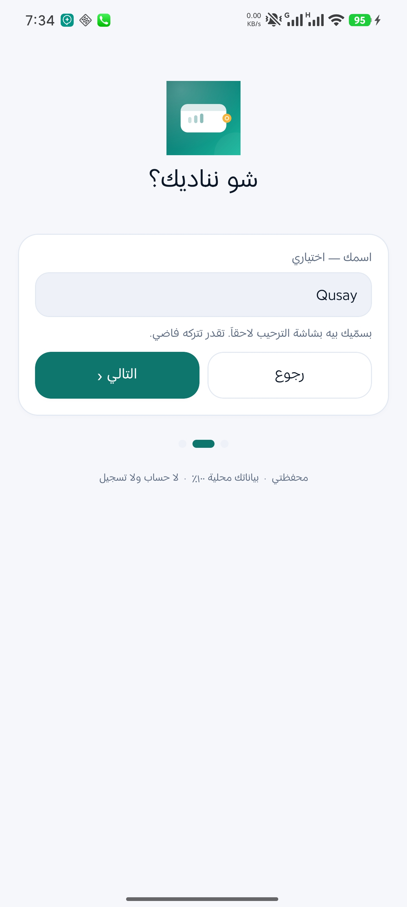<br/><b>✍️ التخصيص</b><br/><sub>اسمك يظهر بشاشة الترحيب</sub></td>
    <td align="center">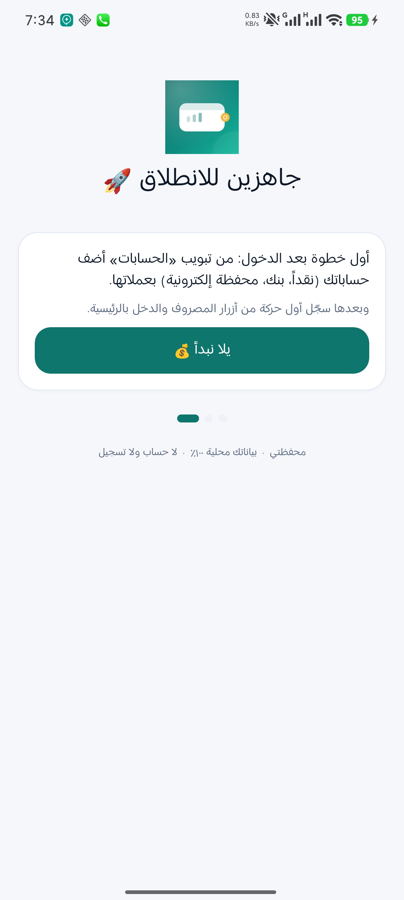<br/><b>🚀 البداية</b><br/><sub>ثلاث خطوات وتنطلق</sub></td>
    <td></td>
  </tr>
</table>

---

</div>

## 💰 Mahfazati — Your Personal Wallet, Fully Offline, Fully Yours

An open-source Android personal finance app built for the Syrian context: works **completely offline**, stores all your data **encrypted locally on your device only**, and understands the reality of multi-currency money with shifting exchange rates.

### Why Mahfazati?
- **Offline-first**: Everything works without internet — no accounts, no sign-in, no servers. Your data never leaves your device.
- **Multi-currency with realistic rates**: Syrian Pound (parallel "souq" & official market), USD, EUR, TRY, CNY — with separate buy/sell rates, just like the real market.
- **Auto or manual rates**: Refresh Damascus parallel-market rates with one tap (source: sp-today), or enter them manually.
- **Biometric lock**: Fingerprint/face lock with auto-lock after 15 minutes away, hidden-amounts mode, and screenshot blocking.
- **Full encryption**: Financial data and internal backups are stored AES-256-encrypted with the key protected by Android Keystore.
- **Smart backups**: Automatic daily backups (last 7 days) + full JSON export/import + a safety snapshot before any restore.

### Features
| Feature | Description |
|---|---|
| 🏠 Home | Total wealth across all currencies, converted to SYP and USD |
| 💳 Accounts | Cash, bank, e-wallets — in different currencies |
| ➖➕ Transactions | Expense / income / transfers with automatic currency conversion |
| 🤝 Debts | "owed to me" & "I owe" with paid tracking |
| 🎯 Savings | Savings goals with progress bars |
| 📊 Reports | Expense breakdown by category with charts |
| ⚙️ Settings | Light/dark theme, custom categories, exchange rates, security |

### Tech Stack
React Native 0.88 · Expo SDK 58 · expo-router · TypeScript · Hermes · AES-256 (aes-js) + Android Keystore

---

## 📥 Installation · التحميل

<div dir="rtl">

حمّل `Mahfazati-2.0.0.apk` من قسم [Releases](../../releases)، فعّل «التثبيت من مصادر غير معروفة»، ثم ثبّت الملف. التطبيق مجاني وبلا إعلانات وبلا أي صلاحيات إلا اللازم.

</div>

Download `Mahfazati-2.0.0.apk` from the [Releases](../../releases) section, allow "Install from unknown sources", and install. Free, no ads, and requests only the permissions it truly needs.

## 🔨 Building from source · البناء من المصدر

```bash
git clone <repo-url> && cd <repo>
npm install
cd android && ./gradlew assembleRelease
# APK: android/app/build/outputs/apk/release/app-release.apk
```

<div dir="rtl">

ملاحظة: البناء يحتاج ملف توقيعك الخاص في `signing/` (غير مرفوع لأسباب أمنية) — راجع `android/app/build.gradle`.

</div>

Note: Release builds require your own signing key in `signing/` (not uploaded for security reasons) — see `android/app/build.gradle`.

## 🔒 Privacy & Security · الخصوصية والأمان

<div dir="rtl">

التطبيق **لا يجمع ولا يرسل أي بيانات** — الشبكة تُستخدم فقط لجلب أسعار الصرف عند طلبك. البيانات محفوظة مشفّرة على جهازك، ولا يمكن استخراجها إلا من داخل التطبيق. لا تُنسخ البيانات مع نسخ أندرويد السحابية (allowBackup=false). إن مسحت التطبيق تُمسح البيانات معه — صدّر نسخة احتياطية أولاً.

</div>

The app **collects and sends nothing** — the network is used only to fetch exchange rates when you ask. Data is stored encrypted on your device and cannot be read outside the app. Android cloud backup is disabled (`allowBackup=false`). Uninstalling the app deletes its data — export a backup first.

## 📄 License

MIT — see [LICENSE](LICENSE).
